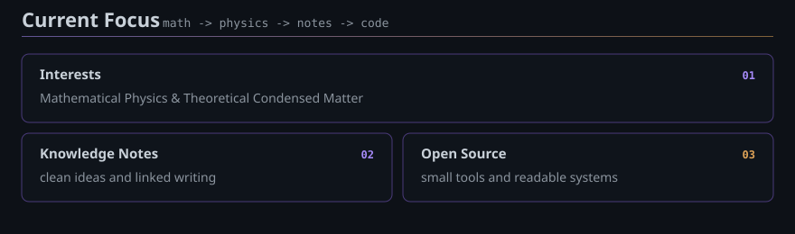
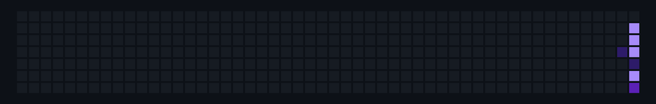



<strong>Department of Physics · Westlake University</strong>

<h3><a href="https://jiamingshi-jsphys.github.io/JiamingShi-JsPhys/">→ Full dynamic profile →</a></h3>

 

 

 

## Contact

  
  &nbsp;
  

symmetry · physics · computation

